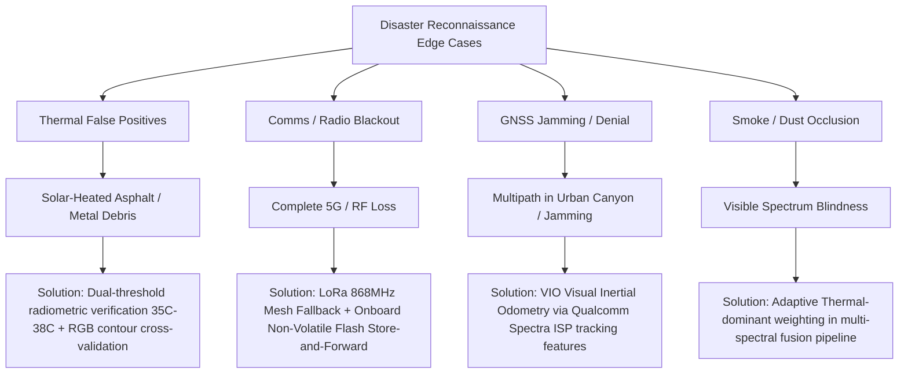

# Problem Statement Analysis: SIH26177 (Qualcomm Inc.)

**Problem Title**: Autonomous AI-Powered Search and Rescue (SAR) UAV for Disaster Reconnaissance  
**Organization**: Qualcomm Inc.  
**Category**: Hardware | **Theme**: Robotics and Drones  
**Author**: Team Phoenix (Systems Engineering & Pitch Strategy)  

---

## 1. Context and Problem Characterization

Disaster response operations following earthquakes, landslides, flash floods, or industrial collapses are governed by the **72-Hour "Golden Window"**, within which the probability of extricating trapped survivors alive drops exponentially with every passing hour.

```
Survival Probability vs. Post-Disaster Time Elapsed
100% ┼───────╮
 80% │       ╰──╮  [Golden Window: 0 - 72 Hours]
 60% │          ╰──╮
 40% │             ╰──────╮
 20% │                    ╰────────────
  0% ┼───────┴────────────┴────────────┴───────
     0h     24h          48h          72h     96h+
```

### Critical Operational Bottlenecks in Conventional SAR:
1. **Terrain Inaccessibility**: Rubble, damaged bridges, mud deposits, and flood currents prevent ground personnel and wheeled/tracked robotic rovers from reaching ground zero during initial hours.
2. **Environmental Occlusion**: Dense smoke, suspended particulate dust, post-disaster fires, and night operations completely blind conventional optical RGB cameras.
3. **Infrastructure Collapse**: Cellular backhauls (4G/5G towers) and power grids are routinely severed or destroyed, prohibiting cloud-reliant AI services.
4. **GNSS Vulnerability**: "Urban canyon" multipath reflections from collapsed buildings, magnetic anomalies from twisted rebar, or intentional/unintentional RF interference severely degrade standard civilian GPS.
5. **High False-Positive Latency**: Human operators reviewing raw drone video feeds suffer cognitive fatigue; manual detection of victims under rubble takes 15–40 minutes per square kilometer.

---

## 2. Deep Dive into Qualcomm's Strategic Expectations (SIH26177)

Qualcomm’s sponsorship of this problem statement indicates distinct evaluation priorities that differentiate winning proposals from generic hobbyist drone entries:

| Evaluation Dimension | Conventional Academic Drone Approach | Team Phoenix's Qualcomm-Centric Architecture |
| :--- | :--- | :--- |
| **Compute Hardware** | Heavy, power-hungry desktop GPU or NVIDIA Jetson Orin Nano (25W–40W) | **Qualcomm Flight™ RB5 Platform (Snapdragon QRB5165)** utilizing the **Hexagon™ 698 DSP/NPU (15 TOPS) at <12W** |
| **Inference Pipeline** | Unquantized FP32 PyTorch / ROS nodes | **INT8 Quantized YOLOv8/v10 via Qualcomm SNPE SDK** running natively on Hexagon Vector Extensions (HVX) |
| **Perception Strategy**| RGB-only or unaligned thermal display | **Hardware-synchronized Spatial/Radiometric Dual-Stream Fusion (RGB + LWIR)** |
| **Geolocation Strategy**| Naive drone GPS tag (where drone hovers) | **Real-Time 3D Ray-Casting Projection** resolving exact ground victim coordinates |
| **Connectivity** | Standard Wi-Fi or cellular with failure upon disconnect | **Hybrid Dual-Band 5G + LoRa Tactical Mesh (868/915 MHz)** store-and-forward telemetry |
| **Power Efficiency** | Short flight times (<18 mins) due to heavy compute payload | **Lightweight SWaP-C profile** yielding **32–38 minutes** operational endurance |

---

## 3. Requirements Specification Matrix

### 3.1 Functional Requirements (FR)
* **FR-01 (Multi-Spectral Acquisition)**: Capture synchronized 4K visible optical imagery and $640 \times 512$ Long-Wave Infrared (LWIR) radiometric thermal imagery at $\ge 30\text{ FPS}$.
* **FR-02 (Edge Object Detection)**: Identify human beings (standing, prone, trapped under partial rubble, gesturing) with an inference latency $\le 35\text{ ms}$ per frame entirely on-board.
* **FR-03 (Precision Geolocation)**: Compute ground survivor WGS-84 coordinates (Latitude, Longitude, Estimated Altitude) within a spherical error probable (SEP) of $\le 2.5\text{ m}$.
* **FR-04 (Autonomous Triage Classification)**: Tag detections with a multi-factor triage priority rating (Critical, Urgent, Non-Urgent) based on temperature delta, movement vector, and environment.
* **FR-05 (Resilient Telemetry Transmission)**: Broadcast compressed victim metadata (Timestamp, Lat/Long, Triage Score, Thumbnail crop) over LoRa to ground command within $\le 3\text{ seconds}$ of detection.

### 3.2 Non-Functional Requirements (NFR)
* **NFR-01 (Power & Compute Budget)**: Total companion compute + sensor payload draw must remain within $\le 15\text{W}$ at peak inference to preserve flight battery.
* **NFR-02 (Flight Endurance)**: Total operational flight time must achieve $\ge 30\text{ minutes}$ on a single standard 6S LiPo/Li-Ion pack with full payload.
* **NFR-03 (Environmental Ruggedness)**: Dust and water resistance rated to IP54; operation in ambient temperatures from $-5^\circ\text{C}$ to $+50^\circ\text{C}$.
* **NFR-04 (Cybersecurity & Integrity)**: Cryptographic signing (Ed25519) of telemetry packets and encrypted command links (AES-256-GCM) to prevent malicious spoofing or hijacking.

---

## 4. Edge-Case Hazard & Mitigation Analysis



---

## 5. Indian Regulatory & Operational Compliance

The architecture complies with the **Directorate General of Civil Aviation (DGCA) & Ministry of Civil Aviation (MoCA) Drone Rules 2021 / 2023 Amendments**:
* **NPNT (No Permission, No Takeoff)**: Firmware-level geofence and digital sky token compliance interface.
* **Fail-Safe Returns**: Autonomous Return-To-Home (RTH) upon dual battery threshold trigger ($<20\%$).
* **Green Zone Deployment**: Emergency SAR missions qualify for expedited priority dispatch under National Disaster Management Authority (NDMA) protocols.
